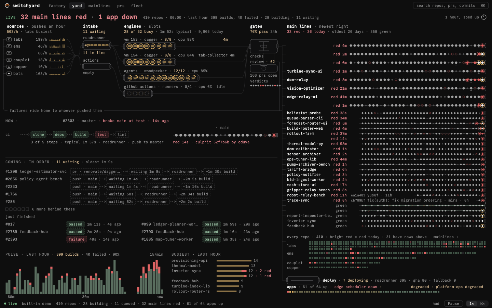
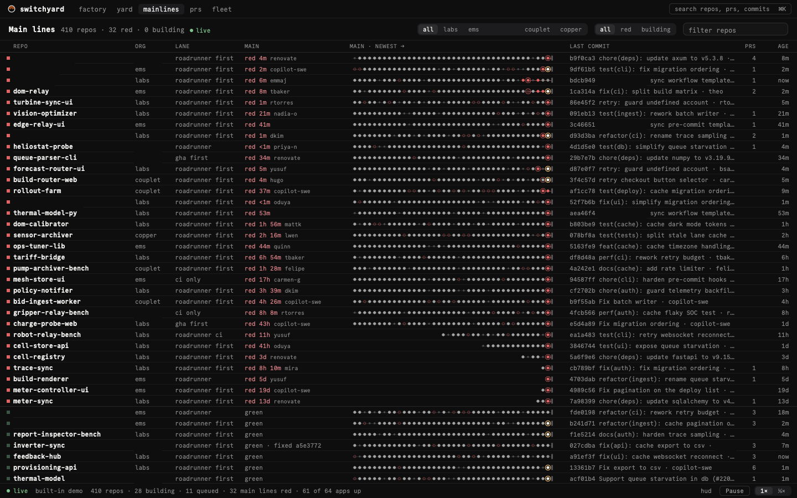
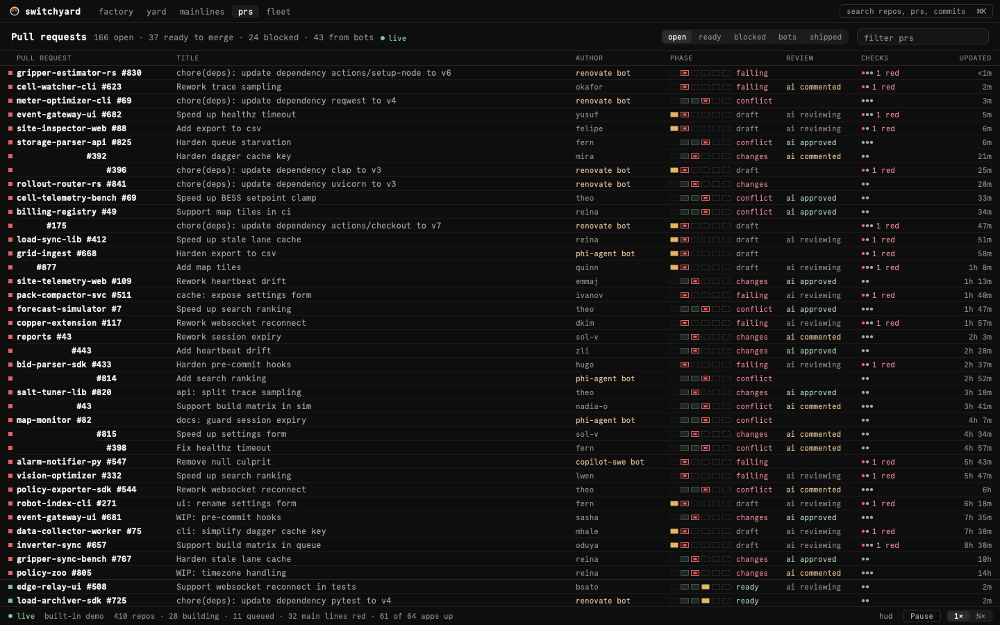

# Switchyard

**Every commit, pipeline, PR, deploy and app in one living schematic.**

Switchyard is a live control room for a whole CI/CD fleet: commits travel the wires as packets
from push through the Roadrunner and GitHub Actions lanes, gates and deploys to the apps they
land on, with every repo's main line, every open PR and every app's health beside it. A native
macOS app and a web app, fed by one Rust server that keeps the fleet in memory and streams deltas.

[](https://github.com/couplet-physical-ai/switchyard/releases/latest)
[](LICENSE)

```sh
brew tap couplet-physical-ai/tap && brew trust couplet-physical-ai/tap && brew install --cask switchyard && open -a Switchyard
```

<p align="center">
  
</p>

| Main lines | PRs |
|---|---|
|  |  |

<sub>The macOS app on the built-in demo fleet. Screenshots: <code>packaging/screenshots/</code>.</sub>

## What's here

- `app/` — the client, built on [Exact](https://github.com/expo/exact) (web + macOS).
- `server/` — `switchyard-server`, a Rust service that ingests the CI/CD upstreams, keeps the
  fleet's live state in memory and streams deltas to every client.
- `contract/` — the wire contract between the two, with fixtures.

## Install

- **macOS** (Apple Silicon, macOS 14+): the one-liner above. It updates itself: **Update** in the
  app (or `brew upgrade --cask --greedy switchyard`).
- **Web**: <https://switchyard.apps.example.com> (Exowatt SSO).

Details, the dmg route and troubleshooting: [packaging/INSTALL.md](packaging/INSTALL.md).
Releasing: [packaging/RELEASING.md](packaging/RELEASING.md)
(`scripts/release.sh <version>`).

Status: under construction.

License: MIT.
