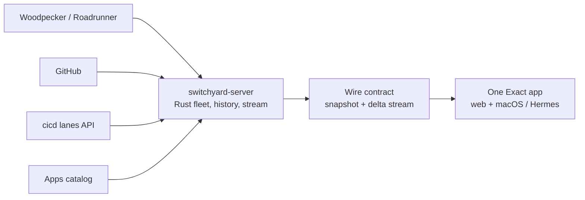

# Architecture

Switchyard collects CI/CD state from four upstreams, reduces it into one in-memory fleet, and serves a versioned snapshot-plus-delta protocol. The web and macOS clients are one Exact app with different hosts.

## Upstreams

Woodpecker supplies live pipeline changes and queue state. GitHub supplies repository, commit, pull-request, and Actions data. The cicd API adds lane policy and deployment signals; the apps catalog provides app inventory and health. Each source is polled or streamed once by the server, regardless of client count. See [server architecture](server.md) for adapter behavior and cadence.

## Server

[`switchyard-server`](https://github.com/couplet-physical-ai/switchyard/tree/main/server) is a Rust service. It owns an in-memory fleet model, history and replay, and the stream fan-out. It derives entities from upstream facts rather than relying on arrival order. Read [the server page](server.md) for reduction, warm boot, authentication, and API details.

## Wire contract

The server publishes a snapshot and then ordered frames that update it. Sequence numbers let clients resume; a reset tells a client to fetch a new snapshot. The protocol is versioned in [`contract/CONTRACT.md`](https://github.com/couplet-physical-ai/switchyard/blob/main/contract/CONTRACT.md). See the [contract reference](../reference/contract.md) for an orientation and the canonical contract text.

## Clients

[`app/app.contract`](https://github.com/couplet-physical-ai/switchyard/blob/main/app/app.contract) defines the UI, state, and tasks; [`app/app.ts`](https://github.com/couplet-physical-ai/switchyard/blob/main/app/app.ts) implements its data module and canvas drawing. Exact runs the same app in a browser for the web client and in a native macOS host with Hermes. See [client architecture](client.md).

## Build and operations

GitHub Actions checks the source repository; a separate deployment, outside this repository, deploys the web build and server together with the site's configuration. The macOS app has its own GitHub Actions release workflow. See [developing](../guides/developing.md), [deploying](../guides/deploying.md), [installing](../guides/install.md), and [releasing](../guides/releasing.md).
