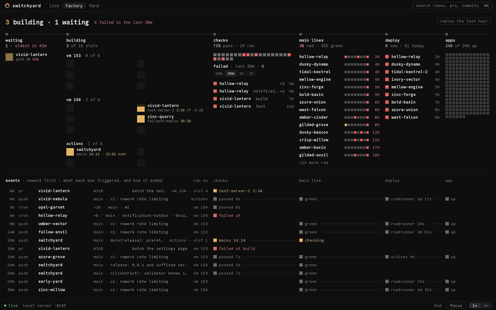
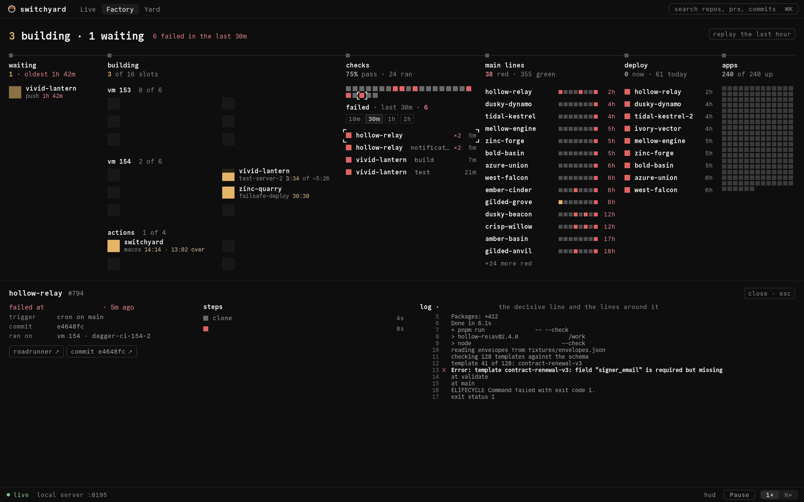
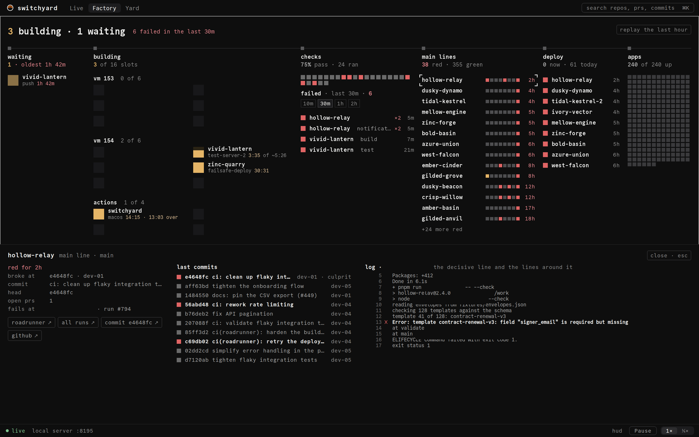

# Reading the Factory

The Factory (`/factory`) is **the berth board**: the delivery line as six stations in flow
order, over a ledger of the latest events traced through the same stations. It is built like a
signalling panel: dark and still when the fleet is fine, a square lights amber while it works and
turns red when it breaks, and nothing moves unless a run really changes place.



The board is fixed to the window. There is no scroll, no drag and no zoom; detail comes from
pressing things. Every `/factory?v=…` link (the retired older floors used `?v=1` and `?v=2`)
opens this board.

## The headline

One sentence: `3 building · 1 waiting   6 failed in the last 30m`, plus `N apps down` when
there are any, or `nothing building · last event 2m ago` when the fleet is idle. The failure count
follows the failed bin's window (below). **replay the last hour** (top right) plays the real
recorded hour at 60× through the same board; **back to live** in the status line returns.

## The six stations

A run only ever goes left to right.

| Station | What it holds | What its head says |
|---|---|---|
| **waiting** | Runs that have no machine yet, oldest first, with how long each has waited. | How many, and the oldest wait (red past an hour). |
| **building** | One **berth** per real slot of each machine (`vm 153`, `vm 154`, the agents, `actions`). A lit berth is a run on that slot: repo, the step it is on, its timer, `of ~typical`. The square fills as elapsed time over typical time; `over` when it runs long. | `3 of 16 slots`. |
| **checks** | One square per run that finished in the window, oldest to newest, and under it the **failed** bin. | The pass rate and how many ran. |
| **main lines** | Only the red ones, newest broken first, each with its last 8 commits as beads and how long it has been red (older than a day is dimmed). | `38 red · 355 green`. |
| **deploy** | What is deploying now (with its timer) and apps whose last deploy failed. | `0 now · 61 today`. |
| **apps** | One small square per app. A not-up app is red (down) or amber and named under the grid. | `240 of 240 up`, or `3 not up · 61 up`. |

A berth is a place, not a list position: a run keeps its berth until it leaves, so nothing
shuffles when a neighbour finishes.

## The failed bin

Under the checks: `failed · last 30m · N` and the window chips **10m 30m 1h 2h** (30 minutes by
default; the choice is remembered on the device). One row per failure, newest first: the repo,
the step it failed at, its age. The same repo failing at the same step again is one row with
`×N`. A failure that a newer green run of the same thing has since fixed leaves the bin.

## The ledger

Below the stations, one row per real event (push, pull request, cron, manual), newest first,
traced through the same columns as the stations above: where it ran, its checks, its main line,
its deploy, its app. A hairline joins one stage to the next when one led to the other. Read a row
like a departure board:

```text
1m  push  deploy-wrapper  main · deploy …   vm 154 · slot 2   passed 2m 23s ——— green ——— roadrunner 1m 56s ——— up
```

## The inspector

Press any named thing: a berth, a waiting run, a result square, a bin row, a red main line, a
deploy, an app square, a ledger row or one of its cells. The inspector docks over the ledger; the
stations above never move. Press it again, **close**, or Escape to put it away.

- **A run:** what happened in words (`failed at esign-sync · 5m ago`), the trigger, the commit,
  where it ran, the error line, every step with its duration, and **the log at the decisive
  line**: for a failure the server finds the line that explains it (`around=decisive`) and the
  inspector shows it with the lines around it, not a tail.



- **A main line:** how long it has been red, the commit that broke it and who pushed it, the head,
  the failing step and run, and the last ten commits with the culprit marked.



- **An app:** its health, since when, and its last deploys.

Every link opens in a new tab and comes from the server's own data (never a hard-coded host):
**roadrunner ↗** (the run), the failing step, **commit ↗**, **pr ↗**, **all runs ↗**,
**github ↗**, **app ↗**, **status ↗**, and a machine's page from its header (`vm 153 ↗`).

## Colour and motion

- **grey** is normal: passed, up, an empty berth. Most of the board.
- **amber** is working right now: a run on a slot, a waiting run, a deploy in flight.
- **red** is broken and not yet fixed: a failed run, a red main line, a failed deploy, a down app.

There is no green on the board: at fleet scale, green for "fine" would paint the whole screen and
hide the red.

A square moves only when its run changed place between two versions of the fleet the server sent:
it leaves its old place, rides the station line at right angles and lands in the new one in about
0.6 s. One event, one square, one trip. Opening the page starts no motion. A running job's timer
and fill tick once a second, because that is real work being measured; finished things carry ages
in whole minutes, so they turn together once a minute. With nothing running, waiting or deploying,
the board is not redrawn at all. With reduced motion on, squares simply appear in their new place.

Why the Factory looks like this, and what came before it:
[The Factory is the berth board](../decisions/0001-the-factory-is-the-berth-board.md).
