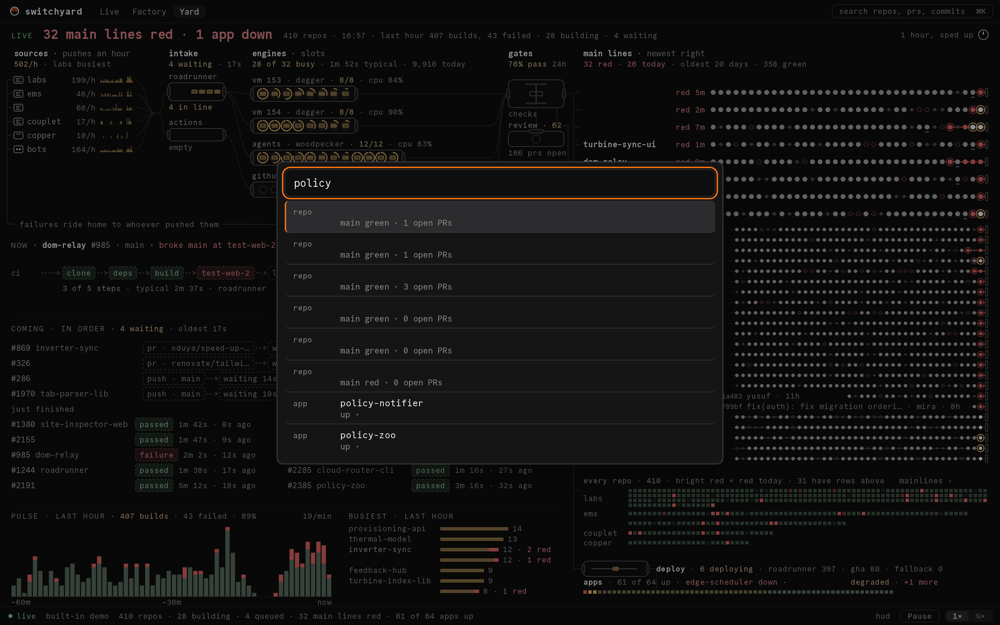

# Links, search and keys

Everything in Switchyard has an address. A view, a filter or an app link can be pasted into chat
and opens the same thing for whoever clicks it. Every run, commit, pull request and app links
out to where it lives.

## Routes

| Route | Opens |
|---|---|
| `/` | Live, the feed. |
| `/?repo=<org>/<name>` | Live filtered to one repository. |
| `/?app=<slug>` | Live filtered to one app: its deploys and health. |
| `/?sha=<org>/<name>@<sha>` | Live filtered to one commit and the jobs it started. |
| `/factory` | The Factory (the berth board). `/factory?v=1`, `?v=2` and `?v=3`, the addresses of retired and staged floors, open the same board. |
| `/yard` | The Yard. |
| `/connect?server=…&token=…` | The connect confirmation (the web form of a `switchyard://connect` link). |

On the web these are paths under <https://switchyard.apps.example.com>. In the macOS app the
same routes are reached through the links below, the palette and the tabs.

## `switchyard://` links (macOS)

The macOS app registers the `switchyard://` scheme.

- `switchyard://connect?server=<url>&token=<token>` asks to connect this device to a server with a
  device token. The app shows the server and asks for confirmation before it saves anything. The
  web sign-in page (`/connect` on the server, behind sign-in) mints a device token and hands it
  back as such a link. Only an `http(s)` server or a bare host is accepted, and a token of
  URL-safe characters; anything else is refused.
- `switchyard://view/<live|factory|yard>` switches to that tab with no confirmation and no
  server change. Scripts use it to drive the installed app, for example the release soak, which
  cycles the tabs with `open switchyard://view/factory`.

!!! warning
    A `connect` link carries a token. Treat it like a password: send it only to yourself, and
    prefer the token file or the Settings field for anything automated
    ([Install and update](install.md)).

## Search (⌘K)

**⌘K** (or the `search repos, prs, commits` field in the top bar) opens one field that finds
repositories, pull requests (`#123` or words from the title), apps, commits (a sha prefix, or
words from the title) and pipelines (`#1767`). Arrow keys move, Return opens, Escape closes.

With the field empty, the palette lists what needs attention first (red main lines, down apps),
then the busiest repositories. A result opens in Live with the matching filter.

## Keys

| Key | Does |
|---|---|
| ⌘1, ⌘2, ⌘3 | Live, Factory, Yard. |
| ⌘K | Search. |
| Escape | Closes the open detail, the Factory's inspector or the palette. |
| Space | Pause and play (Factory and Yard). |
| L | Back to live after a pause or a replay (Factory and Yard). |
| ⌘⇧D | The developer HUD. |

## Links out

Every link out opens in a new tab and is built from the server's own data, never from a
hard-coded host, so a link always points where that fleet's CI and repositories actually live:

| Link | Goes to |
|---|---|
| **roadrunner ↗** | The run in the Roadrunner console (Woodpecker); for a machine, its agent page. |
| failing step | The step's own page, when the CI provides one. |
| **commit ↗** | The commit on GitHub. |
| **pr #N ↗** | The pull request on GitHub. |
| **all runs ↗** | The repository's runs in Roadrunner. |
| **github ↗** | The repository on GitHub. |
| **app ↗**, **status ↗** | The deployed app, and its status page when it has one. |
