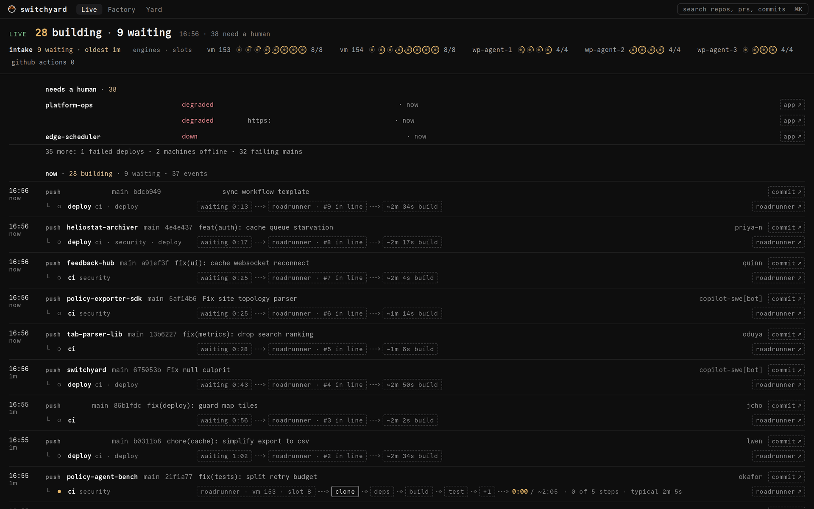
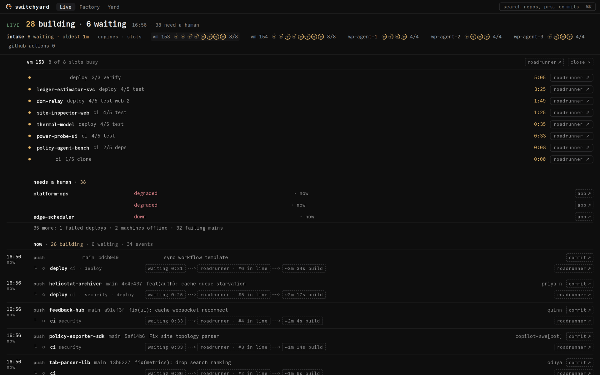
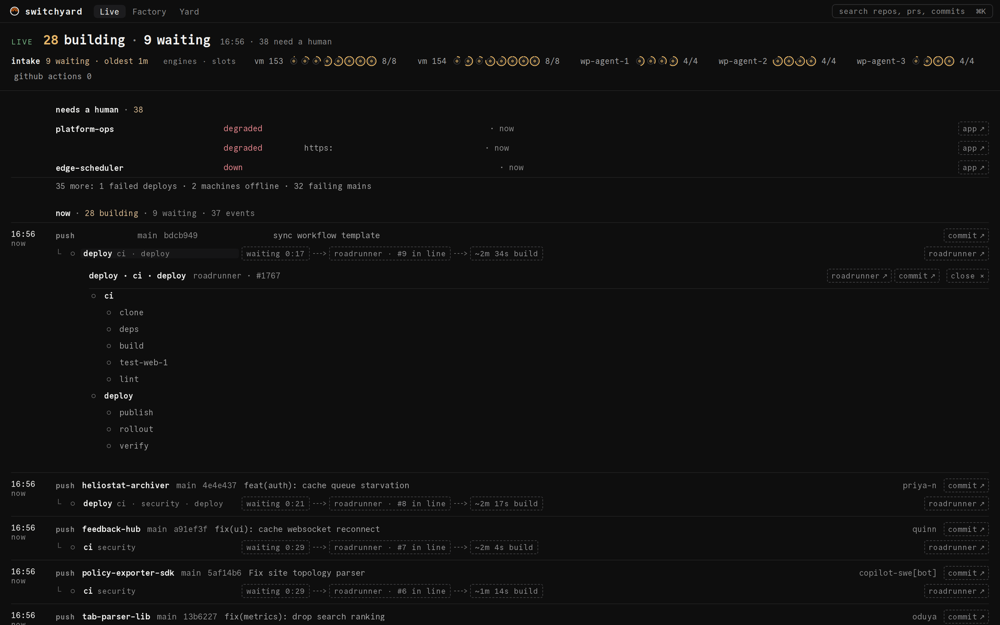
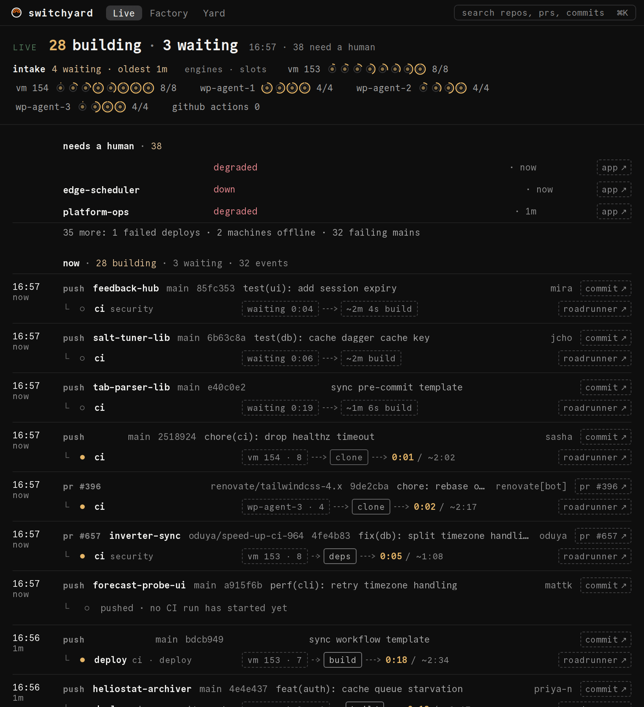

# Reading Live

Live is the default tab (`/`). It is one feed, newest first, that reads like a sentence:
an **event** (a push, a pull request, a cron or a manual run), **every job it started and where
it runs**, and **how it ended**. What needs a human sits above the feed.



## The head

The first line is the count that matters now: `28 building · 9 waiting`, the clock, and how
many things need a human.

Under it, one line for the machines:

- **intake**: how many runs are waiting for a machine, and how long the oldest has waited.
- **engines · slots**: one entry per machine (`vm 153`, `vm 154`, the Woodpecker agents,
  `github actions`), one ring per slot. A filled ring is a busy slot; the fill is how far the
  run is through its usual time. `8/8` is busy of total.

Press a machine to see what runs on each of its slots, with the step, the timer and a
**roadrunner ↗** link per run.



## Needs a human

The top band lists what is broken right now, most urgent first, three at a time with a
`N more:` line that counts the rest by kind:

| Kind | When it appears |
|---|---|
| unhealthy app | An app's health is `down` or `degraded` (with its URL and an **app ↗** link). |
| failed deploy | The newest deploy of an app failed. |
| failing main | A repo's main line is red: its last run failed. |
| stuck job | A running job is over three times its usual time and over 15 minutes. |
| stuck queue | The Roadrunner queue is paused, or its oldest run has waited over 10 minutes. |
| machine offline | A machine stopped reporting. |

## The feed

Events are grouped by time:

- **now**: events with a job still running or waiting.
- **just finished**: events whose jobs all ended in the last 15 minutes.
- **earlier**: the two hours before that, dimmer.

Each event is one block:

```text
16:56   push   atlas-desk  main  bdcb949  chore(autofix): sync workflow template   autofix[bot]  commit ↗
now      └ ○ deploy  ci · deploy   waiting 0:13 ---> roadrunner · #9 in line ---> ~2m 34s build   roadrunner ↗
```

- The left column is the clock time and the age (`now`, `1m`, `2h`).
- The event line: its kind, the repo, the branch, the short sha, the commit or pull request
  title, who did it, and **commit ↗** (or **pr #N ↗**).
- One line per job under it (up to eight; `+N more` after). The glyph and the word carry the
  state:

| Glyph | State | Colour |
|---|---|---|
| `●` | running | amber |
| `○` | queued or waiting | neutral |
| `✓` | passed | neutral |
| `✕` | failed | red |
| `–` | cancelled or skipped | neutral |

- A **waiting** job reads as a chain of chips: how long it has waited, the CI and its place in
  line, the expected build time.
- A **running** job reads: the CI, the machine and slot, its steps as chips with the current one
  boxed, the timer against the usual time (`0:42 / ~2:05`), `N of M steps`, and the typical
  duration.
- A **finished** event shows how each job ended, and for a deploy the app it reached and that
  app's health.

## Detail and the log

Press a job (or an event) to open it in place. You get its workflows and steps with durations,
the error line of a failed step, links (**roadrunner ↗**, **commit ↗**, the step's own page when
the CI provides one), and the log: for a failure, the decisive line and the lines around it
(the server picks it, `around=decisive`), for a running step the tail.



Escape or **close ×** puts it away.

## Filters

A filter keeps the feed to one thing and lives in the URL, so a link to it can be shared:

- `/?repo=<org>/<name>`: one repository.
- `/?app=<slug>`: one app (its deploys and health).
- `/?sha=<org>/<name>@<sha>`: one commit.

Pressing a repo or an app name sets its filter. **show everything** clears it.

## Narrow windows

The feed fits its width rather than scrolling sideways. Under about 1300 px a running job's chain
shortens to where it runs, the live step and the timer; under 1000 px and again under 760 px the
rows tighten further. The machines' line wraps.



## When nothing runs

With nothing running or waiting, the feed says so (`Nothing running right now. Last event 4m
ago.`) and the screen is still: no spinner, no pulse. Ages turn once a minute.
