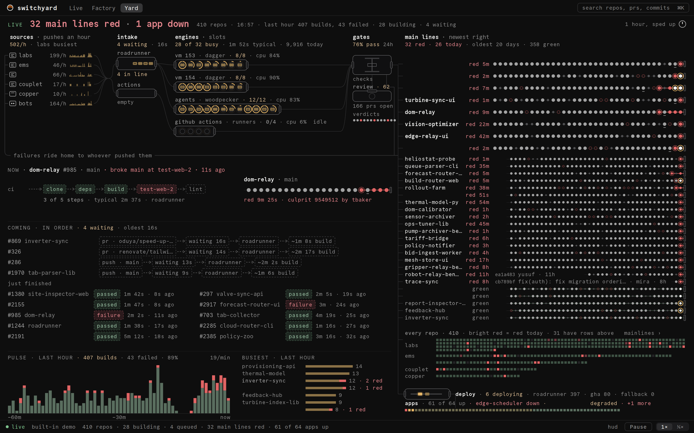

# Reading the Yard

The Yard (`/yard`) is the whole fleet as one schematic. Commits travel the wires as packets,
from where they were pushed, through intake and the engines that build them, past the gates, onto
their repo's main line, and out to deploys and the apps they land on. It is the densest view and
the one to keep on a wall screen.

## Layout

The screen is an L. Across the top left runs the flow (sources → intake → engines → gates), with
the return wire under it. Below are the bands for what is happening now and next. The right-hand
column holds the main lines, then every repo as a heatmap, then deploys and apps.

The headline (`32 main lines red · 1 app down`) is red when something is. The line after it gives
the totals: repos, the clock, builds and failures in the last hour, building and waiting.

## Stations

| Station | Drawn as | Caption |
|---|---|---|
| **sources** | One row per organisation plus bots: pushes an hour and a last-hour sparkline. Wires fan into intake. | `502/h · labs busiest` |
| **intake** | The Roadrunner and GitHub Actions queues; waiting packets dock inside. | `4 waiting · 16s`, `4 in line` |
| **engines** | One lane per machine, sized to its slots, with a ring per slot. A label band names the host, platform, load and CPU. | `28 of 32 busy · 1m 52s typical · 9,916 today` |
| **gates** | The checks clamp, the review machine, and a strip of the last verdicts. | `76% pass 24h`, `166 prs open` |
| **main lines** | Today's red lines at full detail (culprit sha and author over the dot that broke it), then the others worth a row. The newest commit is on the right. | `32 red · 26 today · oldest 20 days · 358 green` |
| **every repo** | One cell per repo, grouped by organisation. Bright red is red today; dim red has been red longer. Hover a cell for its lens. | `every repo · 410` |
| **deploy · apps** | The deploy machine and its counts by lane, then every app as a cell sorted by attention, problem apps named. | `6 deploying · roadrunner 397 · gha 80` |
| **return wire** | Labelled `failures ride home to whoever pushed them`. A failed packet turns red, is named `repo · sha · failing step`, and rides home to its source row. | |

## The bands

- **NOW**: the newest red on a main line (for 10 minutes), else the hottest build. Its steps as
  chips, the failing one red; its main line beside it with the story in words (`red 9m 25s ·
  culprit 9549512 by …`).
- **COMING · IN ORDER**: the queue in order as chip chains (`push · main → waiting 13s →
  roadrunner → ~2m 2s build`), waits over an hour in red; then **just finished**, two columns
  of passed and failed runs.
- **PULSE · LAST HOUR** and **BUSIEST · LAST HOUR**: builds per minute (red for failures) and the
  busiest repos with their failures.

## Packets

A packet is a small rounded rectangle. Amber while it travels; dimmed when docked, so brightness
says "moving now". It travels the wires eased, never over words. Success flashes the gate and
pops a dot on the main line. Failure turns it red, lands on the main line, then rides the return
wire home, named by what broke; NOW jumps to it. When many arrive at once they merge into trains
(`×N`). With reduced motion on, packets appear where they go.

The level of detail follows the size of the window: from 1024×700 every band keeps its words,
and at 2880×1800 the busiest list splits into two columns and the main lines reach about 70 rows.

## Hover and press

Hovering any element opens a lens on it: a repo's full main line, an app's live and main shas, a
pipeline's step and timing, a host's running pipelines. Pressing a pipeline picks it; pressing a
repo or an app opens it in Live with its filter.

## Time

| Control | What it does |
|---|---|
| **live** | The status line's dot; the Yard follows the server. |
| **Pause** (Space) | Freezes the picture. Changes keep arriving in the background; nothing is lost. |
| **1×** | Plays from the pause, behind live, at wall speed; **back to live** jumps to now. |
| **¼×** | Slow motion for a busy moment. |
| **1 hour, sped up** | The dial at the top right: replays the last hour from the server's history at 60×, then returns to live. |

The developer HUD (**hud**, or ⌘⇧D) shows frame times, the quality rung and a stress mode that
puts a synthetic 10× fleet on the wires.
