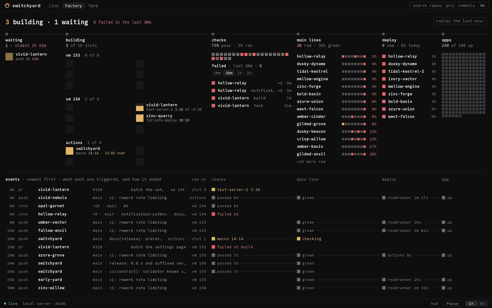
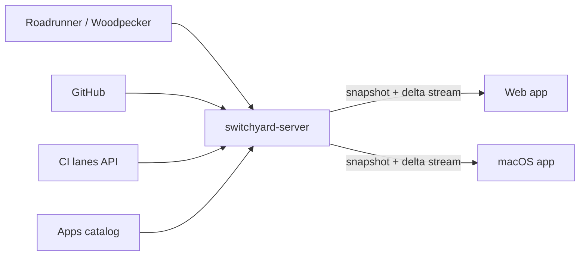

# Switchyard

Switchyard is a live control room for a whole CI/CD fleet. Every commit, pipeline, pull request,
deploy and app shows up in one place, in real time. It answers three questions, in this order:
what is happening right now and where, what did each change trigger and how did it end, and what
is broken and needs a human.



<small>The Factory on the built-in demo fleet (made-up repos and people).</small>

## The three views

| View | Route | What it is for |
|---|---|---|
| **Live** | `/` | The default tab. A feed, newest first: each event (push, pull request, cron, manual run), the jobs it started, where they run, and how they ended. What needs a human sits on top. |
| **Factory** | `/factory` | The berth board. Six stations in flow order (waiting, building, checks, main lines, deploy, apps) over a ledger of events. Fixed to the window; a press opens an inspector with the decisive log line. |
| **Yard** | `/yard` | The original schematic: the whole fleet on one screen, from sources to intake, engines, gates, main lines, deploys and apps, with commits travelling as packets. |

How to read each one: [Live](guides/live.md), [Factory](guides/factory.md), [Yard](guides/yard.md).
Search and deep links: [Links and search](guides/links.md).

## Where to get it

- **Web:** your team's Switchyard server (single sign-on); the server serves the web app at `/`.
- **macOS** (Apple silicon, macOS 14+): Homebrew. It updates itself.

```sh
brew tap couplet-physical-ai/tap && brew trust couplet-physical-ai/tap && brew install --cask switchyard && open -a Switchyard
```

Details, first launch and the token: [Install and update](guides/install.md).

## How it is built

One Rust server keeps the fleet's state in memory and streams changes to every client. It reads
the CI system (Roadrunner, Exowatt's Woodpecker and Dagger CI), GitHub, the CI lanes API and the
apps catalog. The client is one [Exact](https://github.com/expo/exact) app that runs in the
browser and natively on macOS.



Start with [Architecture](architecture/index.md); the wire format is the
[contract](reference/contract.md).

## The rules the design keeps

- **Motion is data.** Nothing moves unless real work moves. When the fleet is idle, the screen
  is still.
- **State is colour on the thing itself**, on its glyph and its status word: amber is working,
  red is broken, grey is fine. No coloured borders, rails, outlines or tinted boxes.
- **Dark, one typeface** (Commit Mono), a fixed palette.
- **One click to the source of truth:** every run, commit, pull request and app links to where
  it lives.

The full language and its history: [Design language](reference/design.md) and
[why the Factory is the berth board](decisions/0001-the-factory-is-the-berth-board.md).

## For contributors

- [Developing](guides/developing.md): toolchain, the mock server, tests.
- [Deploying and operating](guides/deploying.md): CI, the deploy, restarts and warm boot.
- [Releasing the macOS app](guides/releasing.md): gated prerelease, update test, soak, promote.
- [Performance](reference/performance/index.md): how it is measured and every pass.
- [Changelog](reference/changelog.md).
- Post-mortems: [macOS out of memory](reports/incidents/2026-11-11-macos-oom.md) (0.1.3/0.1.4),
  [phantom and stale data](reports/incidents/2026-11-12-phantom-and-stale-data.md).

The source is public: [couplet-physical-ai/switchyard](https://github.com/couplet-physical-ai/switchyard)
(MIT).
